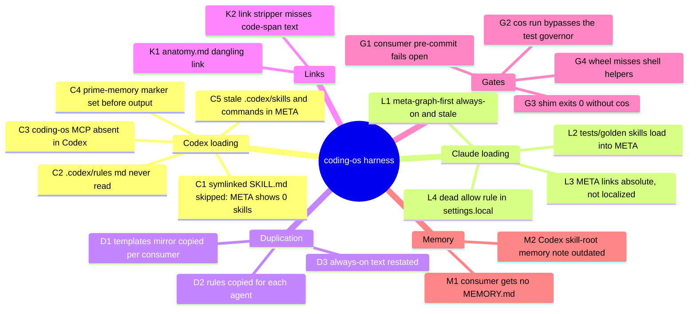

<!-- domain:CORE | layer:engineering | ssot:true | updated:2026-11-26 -->
# Harness Loading & Single-Source Audit — November 2026

> P: The SSOT register for TASK-1133: what Claude Code and Codex actually load from coding-os (in this repo and in a fresh consumer), where the same content exists more than once, and the fix chosen for each finding, checked against community practice.
> R: Before changing how rules, skills, hooks, memory or templates reach an agent, or before a fix task for any finding below. Fix tasks link here instead of restating it.

Measured on 2026-11-26 with Claude Code 2.1.330 and Codex CLI 0.171.0, against this repo (META) and a fresh `cos init -a claude,codex -t fastapi` scaffold (SCAFFOLD).

**Evidence markers.** ✅ re-run by hand during the audit · 🔎 observed by an audit agent, cited to file:line or a command · ⚠️ inferred, not tested. Token counts are bytes/4 estimates.

## Mind map

## Codex loading

**C1 ✅ Codex skips a `SKILL.md` that is itself a symlink.** Probe repo: a real `SKILL.md` and a symlinked skill *directory* were listed by `codex debug prompt-input`; a symlinked `SKILL.md` *file* was not. META's `.codex/skills/*/SKILL.md` are absolute file symlinks (`ls -la .codex/skills/clean-code/`) and META has no `.agents/skills`, so Codex in coding-os itself sees **none of its 53 skills**. SCAFFOLD (real files in `.agents/skills`) lists all 18. Community: Codex documents `.agents/skills` only and follows symlinked skill folders ([codex/skills](https://developers.openai.com/codex/skills)).
*Fix:* META uses the consumer layout: one `.agents/skills/<name>` per skill as a directory link (or real dir), `.claude/skills/<name>` aliasing it; delete `.codex/skills`. Add an install test that asserts `codex debug prompt-input` lists every shipped skill.

**C2 ✅ `.codex/rules/*.md` is never read.** A probe marker in `.codex/rules/x.md` is absent from `codex debug prompt-input`; rule headings appear 0 times in META and SCAFFOLD output 🔎. Codex's `rules/` holds Starlark `.rules` execpolicy files for command approval, not prose ([codex/rules](https://developers.openai.com/codex/rules)). No coding-os hook injects them (only `block-protected-files.sh:92-95` names the path) 🔎. Every always-on rule therefore reaches Codex through nothing.
*Fix:* stop rendering `.codex/rules`. Codex prose comes only from `AGENTS.md` (32 KiB cap, [agents-md](https://developers.openai.com/codex/guides/agents-md)) and skills, so each rule becomes a skill in `.agents/skills` that both agents load on demand, with one pointer line in `AGENTS.md` (see D3). *Fixed in TASK-1135:* Codex declares no rules dir, and the `core-rules` skill links each rule body ([rules-loading.md](rules-loading.md)).

**C3 ✅ The coding-os MCP server is not connected in Codex.** `codex mcp list` in META shows only bundled servers; `~/.codex/config.toml` has trust entries for two other projects only. ⚠️ Cause: the project `.codex/config.toml` is ignored for an untrusted project ([config-advanced](https://developers.openai.com/codex/config-advanced)); a `-c` trust override did not change the listing 🔎, so this needs its own check.
*Fix:* `cos doctor` reports the Codex trust state and the effective MCP list; `cos init` tells the user the one trust step Codex needs.

**C4 🔎 `prime-memory-codex.sh` sets its once-per-panel marker (`:17-20`) before it builds the output (`:22-27`).** A failed `python3` means the index is never delivered and never retried. *Fix:* touch the marker only after a successful emit (memory `fail-open-hooks-hide-dead-triggers`).

**C5 🔎 META carries stale Codex dirs:** `.codex/skills` (written before e0511fb0 moved skills to `.agents/skills`) and `.codex/commands` (commands off since e7065971, `adapter.yaml:116`). *Fix:* removed by the C1 reinstall; `cos doctor` flags adapter dirs that the adapter no longer declares.

## Claude loading

**L1 ✅ `.claude/rules/meta-graph-first.md` loads in every session and is stale.** It carries `globs:`/`alwaysApply:` (Cursor keys Claude Code ignores) where the source `src/templates/meta/rules/graph-first.md:3-8` has `paths:`. Claude loads a rule without `paths:` at launch ([memory docs](https://code.claude.com/docs/en/memory)). `refresh_stack_rules` treats it as a user edit forever because it matches neither source nor mirror (`_init_scaffold.py:246-258`) 🔎. *Fix:* D1's hash baseline makes the refresh correct; then re-render. *Fixed in TASK-1135:* META's stale copy replaced by a link to the source.

**L2 ✅ Nested golden scaffolds load into META sessions.** `tests/golden/claude_*/.claude/{skills,rules}` are discovered, so this session lists `tests/golden/claude_django:*` and `tests/golden/claude_nextjs:*` copies of the same skills. *Fix:* store golden captures under a name no agent discovers (for example `tests/golden/<case>/dot-claude/`) and map it back in the golden comparison. *Fixed in TASK-1135.*

**L3 ✅ META's `.claude/` links are absolute:** `find .claude -type l -lname '/*' | wc -l` gives 290 and the relative count is 0. They are written by `install-adapter.sh` / `install.sh:73`, while the localize contract says META links are relative (`_localize_links.py:9,362-364`). *Fix:* one install path; `install.sh` calls the same localize step `cos update` uses. Still open: the fix lives in `_localize_links.py`, so it left TASK-1135 for its own task.

**L4 🔎 SCAFFOLD `settings.local.json` allows `Bash(bash .coding-os/hooks/write-state.sh:*)`**, a path that does not exist (`src/adapters/claude/settings.local.template.json:25`). *Fix:* point it at the shipped hook path or drop it.

## Duplication (single source)

**D1 ✅ Each consumer carries a copy of its stack templates** in `.coding-os/src/templates/<stack>/` (`_init_scaffold.py:177-189`, `shutil.copy2`/`copytree`). SCAFFOLD: 4 files byte-identical to `src/templates/fastapi` 🔎. META's copy is gitignored and stale: 8 of its 12 files differ from `src/templates/meta` ✅ (`cmp` over `find .coding-os/src/templates/meta -type f`). The only runtime reader is `refresh_stack_rules`, which uses `rules/` as a byte baseline (`_init_scaffold.py:239-269`) 🔎; nothing reads the skills/playbooks/hooks parts. Community: copier and cruft store a reference (template source + commit) and re-render on update, never a template copy ([copier updating](https://copier.readthedocs.io/en/stable/updating/), [cruft](https://cruft.github.io/cruft/)).
*Fix:* record each installed stack rule's sha256 in `.coding-os/managed-files.json` (it already records `kind: copy` + `sha256`, `_localize_links.py:381-386`), compare against that in `refresh_stack_rules`, delete the mirror step and the mirror.

**D2 ✅ Rules are copied once per agent.** SCAFFOLD has 5 `.claude/rules` ↔ `.codex/rules` byte-identical pairs and 3 more that differ (`cmp` over each same-named pair); the 3 differ only by per-adapter link rewriting 🔎. With C2, the `.codex/rules` half is dead weight. Skills already follow the single-copy pattern (`.agents/skills` + `.claude/skills` aliases, `_localize_links.py:238`). *Fix:* C2 removes the Codex copies; rules that stay as Claude rules are path-scoped only. *Fixed in TASK-1135* for Codex; core rules stay always-on for Claude by design.

**D3 🔎 Always-on text is restated across files.** META, repo-owned and always loaded: about 16.4k tokens (AGENTS.md 17,288 B; ten always-on rules; MEMORY.md 5,753 B), plus SessionStart hook text the audit agent estimated at about 1.5k tokens (agent estimate, not re-run). SCAFFOLD: about 12.3k (AGENTS.md 12,256 B + eight rules 36,894 B). The same rule appears in two to five places, for example trunk git (`AGENTS.md:61-62,70`, `git-workflow.md`, `_rules_primer_card.txt:13`), task ops (`AGENTS.md:63,99`, the primer card, `session-context.sh:194-195`), the core loop (`AGENTS.md:70`, `thinking_os.md`, the card, `session-context.sh:197`, `nudge-thinking-os.sh:105`), and graph-first benchmark numbers (`AGENTS.md:103`, `meta-graph-first.md:3-5`). `model-routing.md` loads although routing is off. Community: Anthropic targets under 200 lines per CLAUDE.md and notes that conflicting instructions are picked arbitrarily ([memory docs](https://code.claude.com/docs/en/memory)); "Evaluating AGENTS.md" finds context files add over 20% inference cost and help mainly for non-standard practice ([arXiv 2602.11988](https://arxiv.org/abs/2602.11988)); the Agent Skills spec loads about 100 tokens of metadata per skill and the body on demand ([agentskills.io](https://agentskills.io/specification)).
*Fix:* each rule has one owner file; `AGENTS.md` keeps one line per rule with a link; rule bodies move to skills (both agents) or `paths:`-scoped Claude rules; the rules-primer card goes, and so does the `session-context.sh:189-199` restatement (it fires on compact and resume only, not at startup); `model-routing.md` renders only when routing is on. The audit agent estimated about 3.4k tokens saved across startup, compact and resume text together (agent estimate, not re-run); TASK-1135 measures the real baseline first. Measure before and after with `cos doctor --tokens` (memory `measure-per-profile-never-summed`). *Fixed in TASK-1135:* card and compact block gone, `AGENTS.md` and the consumer fragments cut to pointers; before/after numbers are in the task's work log.

**Decision for the owner: consumer copies of shared skills.** A consumer needs skill files that survive a clone on another machine, so a link into one machine's `cos` install cannot be the shipped form. Every tool surveyed writes files: ruler and rulesync render per agent and gitignore the output ([ruler](https://github.com/intellectronica/ruler), [rulesync](https://github.com/dyoshikawa/rulesync)); copier commits rendered files plus a reference. Two single-source options: (a) **tracked once:** one copy in `.agents/skills`, every other agent dir links to it, the copy verified by sha in `managed-files.json` (today's design, minus D1/D2); (b) **generated:** gitignored, re-rendered by `cos` from the pinned version in `.coding-os.yaml`, so git holds no copy at all but a clone needs `cos` before an agent sees skills. Hooks already need `cos` (G3), which argues for (b); a clone that works without `cos` argues for (a).

## Links

**K1 ✅ `anatomy.md` in the fastapi skill links to a file consumers never get.** SCAFFOLD `.agents/skills/python-fastapi/references/anatomy.md:15` links `../../../scaffold-boundary.yaml`, which does not exist; the consumer's real file is `.coding-os/scaffold-boundary.yaml` (`_init_boundaries.py:22-48`) 🔎. The contract test checks only that the string appears (`tests/test_anatomy_contract.py:113-123`) 🔎.

**K2 🔎 Root cause of K1 surviving localization:** `_unlink_missing` splits text on code spans before matching links (`_localize_links.py:48,293-326`), so a link whose text is in backticks is never seen. Community: build-time link validation runs strict in CI ([mkdocs validation](https://www.mkdocs.org/user-guide/configuration/)); a generator can only catch this in its own CI by linting a rendered sample ⚠️ (composed practice, no single source found).
*Fix:* match link text containing code spans; point anatomy.md at `.coding-os/scaffold-boundary.yaml`; make the contract test resolve the link as a consumer sees it; CI runs `cos doc-lint` on each rendered stack scaffold.

## Gates

**G1 ✅ The consumer pre-commit hook fails open (TASK-1094).** In a SCAFFOLD copy: `bash .git/hooks/pre-commit` prints `WARNING — batch helper missing; skipping hook scan.` and exits 0. The hook is a frozen copy of `src/scripts/_pre_commit_body.sh` installed at init only (`_init_git.py:263-293`) and looks for helpers beside `.claude/hooks/cos-env.sh`, which localization drops (`_localize_links.py:369-373`) 🔎. Community: a distributed hook calls the tool's installed entry point, not a path into its source ([pre-commit](https://pre-commit.com/#new-hooks)).
*Fix:* `.git/hooks/pre-commit` becomes a stub that runs the body through `cos` (or `hook-shim.sh --print-root`), so fixes reach existing consumers; missing helper fails closed with one install line.

**G2 ✅ `cos run` bypasses the test governor.** The governor's fast path exits unless the command mentions `pytest` or `make ` (`test-governor.sh:28-31`), so `cos run test-backend` gets no dedup, lock or sweep gate, while the recorder does ledger it (`record-verify-auto.sh:21,30`) 🔎. The consumer suite's `paths: backend/**` does not match the fastapi layout `src/backend/`, so the suite is never required (`src/core/board_os/verify-suites.yaml:104-107`) 🔎. Community: Claude Code's Bash rules match command text and are not a security boundary ([permissions](https://code.claude.com/docs/en/permissions)); Codex execpolicy treats a complex `bash -lc` as one opaque command ([codex/rules](https://developers.openai.com/codex/rules)).
*Fix:* the gate moves into `cos run` itself (dedup, lock, sweep check before `subprocess.run`) and `cos run` writes the ledger entry from its own exit code; the hook only routes raw test commands to `cos run`. Suite paths come from the stack's `scaffold-boundary.yaml` roots.

**G3 ✅ Without `cos` on PATH every hook exits 0** (`hook-shim.sh:8,44`), enforcement hooks included. *Fix:* the shim fails closed for hooks registered as blocking in `registry.yaml` and open for observers, with a one-line install hint.

**G4 ✅ The wheel ships `hooks/_helpers/*.py` but not `*.sh`** (`pyproject.toml:262`), so `git_index_lock.sh` and `run_with_reap_timeout.sh` are missing in a PyPI install; `enforce-commit-message.sh:46` then skips its index-lock wait silently. *Fix:* add `hooks/_helpers/*.sh` to the package data and a wheel-content test.

## Memory

**M1 ✅ A consumer gets no `.agents/memory/`.** SCAFFOLD has no such dir, and `rg -n 'MEMORY\.md' src/cli` finds only the lint command's docstring (`project_commands.py:47`), so nothing seeds it; Codex's `prime-memory-codex.sh` exits silently without it, and Claude's memory link is made only on the first session. *Fix:* `cos init` seeds an empty `MEMORY.md` index and `cos memory-lint` runs in consumers.

**M2 🔎 The memory note `codex-reads-both-skill-roots` (0.164) misses C1's caveat** that a symlinked `SKILL.md` file is skipped. *Fixed in TASK-1133:* the note and its index line now carry it. ⚠️ `ensure-agent-memory-link.sh:14` maps only `/` and `.` when deriving Claude's project slug; a path with other characters may link a directory Claude never reads. Test this before relying on it.

## Checklist

| ID | Fix | Single source after the fix | Verify by running | Task |
|---|---|---|---|---|
| C1, C5 | META on `.agents/skills`; drop `.codex/skills`, `.codex/commands` | `.agents/skills/<name>` | `codex debug prompt-input` lists every skill | TASK-1134 |
| C2, D2, D3 | Rules to skills + one pointer line; stop `.codex/rules`; cut restatements | one owner file per rule | `cos doctor --tokens` before/after per profile | TASK-1135 |
| L1, L2, L3 | Re-render graph-first; hide golden `.claude`; one install path | `src/templates/meta/rules` | session skill list has no `tests/golden:*` | TASK-1135 |
| D1 | Hash baseline in `managed-files.json`; delete mirror | `managed-files.json` | `cos update` keeps a user-edited rule, refreshes an untouched one | TASK-1136 |
| K1, K2 | Fix link stripper; retarget anatomy link; CI lints rendered stacks | `.coding-os/scaffold-boundary.yaml` | `cos doc-lint` clean on every rendered stack | TASK-1137 |
| G1 | Pre-commit stub through `cos` | `src/scripts/_pre_commit_body.sh` | `git commit` in a fresh scaffold scans hooks | TASK-1094 |
| G2 | Gate and ledger inside `cos run`; suite paths from boundary roots | `cos run` | a second `cos run test-backend` on a green tree is refused | TASK-1138 |
| G3, G4 | Blocking hooks fail closed without `cos`; ship `_helpers/*.sh` | `registry.yaml` blocking flag | shim test with `cos` off PATH; wheel listing | TASK-1138 |
| C3, C4, M1, L4 | Codex trust check in doctor; marker after emit; seed MEMORY.md; fix the allow rule | `.agents/memory/MEMORY.md` | `cos doctor` on a fresh scaffold | TASK-1139 |
